# Escala Connect — Manual do Líder

Este manual explica as ferramentas de liderança do **Escala Connect**. Tudo o que o voluntário faz (confirmar, avisar impedimento, marcar disponibilidade…) também vale para você — veja o **Manual do Voluntário**.

> Vale para o app **versão 1.1.0** e para o site **connect.pibvp.org.br**. Quase tudo pode ser feito pelos dois; quando algo é só do site, está indicado.

---

## 1. Onde ficam as ferramentas

- **No app:** a aba **Liderança** aparece só para líderes. O número vermelho na aba mostra quantas pendências esperam por você.
- **No site:** menu **Painel do Líder** (resumo do mês, pendências, vagas e disponíveis) e a página de cada equipe.

A aba **Liderança** tem três partes:

| Parte | O que mostra |
|---|---|
| **Pendências** | Impedimentos, trocas, ofertas "quero servir" e pedidos para entrar na equipe |
| **Cultos** | Os próximos cultos das suas equipes, com quem confirmou, quem falta e as vagas |
| **Vagas** | Funções ainda sem ninguém, com quem se ofereceu e quem está disponível |

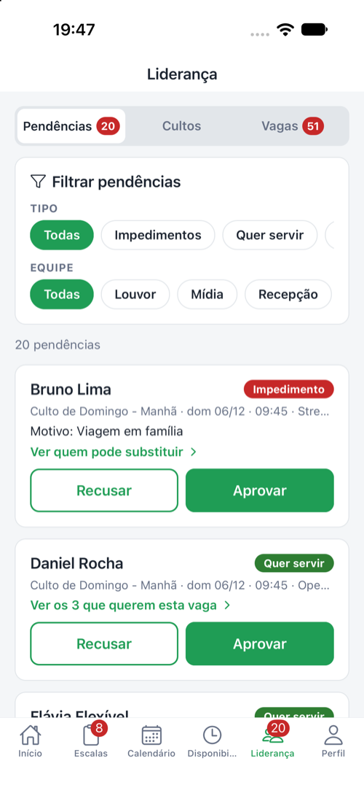 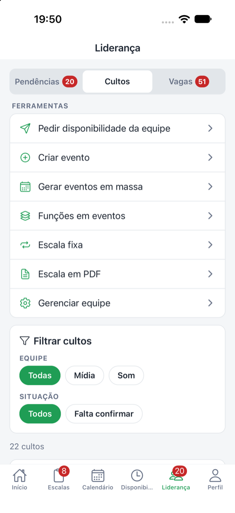

Na parte **Cultos** ficam as **Ferramentas**: pedir disponibilidade, criar eventos, gerar eventos em massa, funções em eventos, **escala fixa**, escala em PDF e gerenciar equipe.

---

## 2. Fluxo de cada mês (resumo)

1. **Cultos e funções:** garanta que os cultos do mês existem e têm as funções da sua equipe (seção 7).
2. **Disponibilidade:** peça para a equipe marcar os dias (seção 3).
3. **Escalar:** preencha as vagas (seção 4) — ou deixe a **escala fixa** fazer isso sozinha (seção 8).
4. **Confirmações:** acompanhe quem confirmou e peça confirmação de quem falta (seção 5).
5. **Pendências:** resolva impedimentos, trocas e ofertas assim que chegarem (seção 6).
6. **Divulgar:** compartilhe a escala em PDF no grupo da equipe (seção 9).

---

## 3. Pedir disponibilidade da equipe

**Liderança → Ferramentas → Pedir disponibilidade da equipe**
1. Escolha a **Equipe** e o **Mês**.
2. Veja quem **ainda não marcou** nada naquele mês (**Faltam marcar**).
3. Toque em **Pedir pelo app** (notificação) ou **Pedir pelo app e por e-mail**.

Só quem ainda não marcou recebe o pedido.

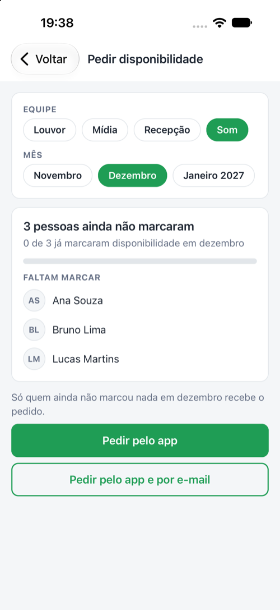

---

## 4. Escalar pessoas nas vagas

### Pela aba Vagas
**Liderança → Vagas** lista as funções sem ninguém. Use **Filtrar vagas**: **Querem servir**, **Com disponíveis**, **Sem ninguém**.

Toque na vaga para escolher a pessoa. A lista mostra primeiro:
1. quem **se ofereceu** ("Se ofereceu");
2. quem marcou **disponibilidade** para aquele culto;
3. os demais integrantes (use **Buscar pessoa**).

O app avisa se a pessoa já está escalada em outra função naquele culto. Ao escalar, a pessoa recebe **"Você foi escalado 🙌"**.

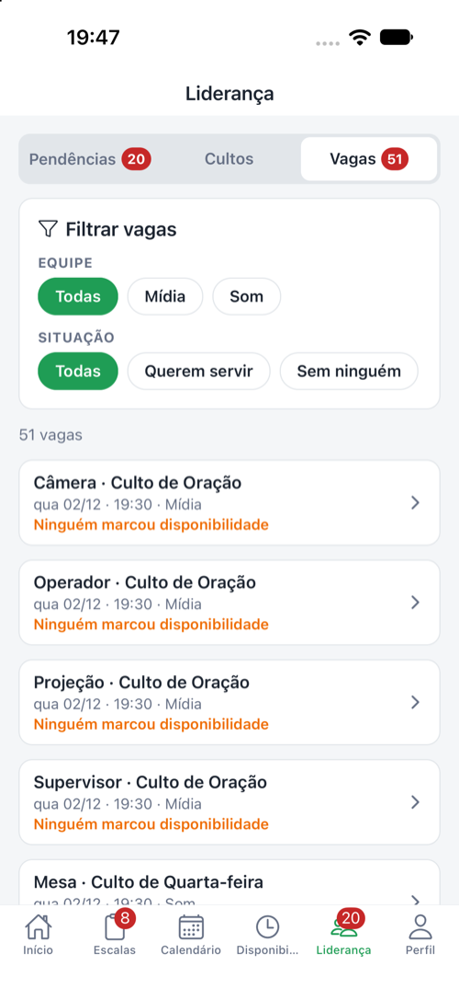 

### Pela tela do culto
**Liderança → Cultos** → toque no culto. Você vê cada função com quem está escalado, quem confirmou e as vagas. Toque numa vaga para escalar, ou numa pessoa que ainda não confirmou para **trocar por outra** (quem sai recebe o aviso "Mudança na sua escala").

No **Calendário**, ao tocar num dia, cada culto mostra o resumo da **sua equipe** (vagas em aberto, quem quer servir, quem falta confirmar) e o botão **Abrir o culto para escalar**.

 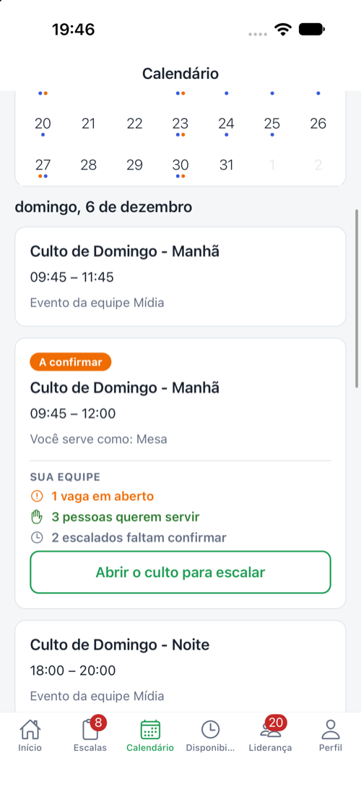

### Auto-escalar (site)
Na página de **Escalas da equipe**, o botão **Auto-escalar** preenche as vagas em aberto com quem está disponível, fazendo rodízio (quem serviu menos vem primeiro) e respeitando um limite de escalas por mês.

---

## 5. Confirmações

Em **Liderança → Cultos**, use **Filtrar cultos → Falta confirmar**. Abra o culto e toque em **Pedir confirmação pelo app** (ou **Pedir pelo app e por e-mail**). Só quem ainda não confirmou recebe.

Além disso, o sistema lembra sozinho:
- na véspera, às 18h, quem não confirmou ("Confirma sua escala?");
- lembrete da escala (véspera às 20h para cultos de manhã; no dia às 12h para os demais);
- 2 horas antes, quem ainda não confirmou.

---

## 6. Pendências

Você recebe um aviso no celular quando surge uma pendência na sua equipe. Abra **Liderança → Pendências** (use **Filtrar pendências** para ver só um tipo). No site, o **Painel do Líder** tem os mesmos itens, com o filtro **Todas · Impedimentos · Trocas · Querem servir**.

Cada pendência tem os botões **Aprovar** e **Recusar**, e um atalho para abrir o culto ou a vaga e decidir com mais contexto.

### Impedimento ("não vou poder servir")
Leia o **motivo** e escolha:
- **Aprovar:** libera a pessoa ("Impedimento aceito"). O app pergunta se você quer **escalar outra pessoa agora**; se não, a vaga vai para a lista de vagas.
- **Recusar:** a pessoa continua escalada e recebe o aviso "Você continua escalado".
- **Já ter um substituto em mente:** abra a vaga pelo atalho e toque na pessoa nova — o pedido é aprovado e o substituto já fica escalado. Na mesma tela, em **Decidir sem substituto**, estão **Aprovar e deixar a vaga aberta** e **Recusar**.

### Pedido de troca
Funciona igual ao impedimento: aprove (escalando um substituto ou deixando a vaga aberta) ou recuse.

### "Quero servir" (oferta para vaga)
Alguém se ofereceu para uma vaga em aberto.
- **Aprovar:** a pessoa é escalada e recebe "Você foi escalado 🙌". As outras ofertas para a mesma vaga são encerradas automaticamente.
- **Recusar:** a oferta é descartada e a vaga continua aberta.
- Quando várias pessoas querem a mesma vaga, use **Ver os N que querem esta vaga** para comparar antes de escolher.

Para não lotar seu celular, a **primeira** oferta para um culto chega como notificação ("Voluntário para a vaga"); as seguintes, nas próximas 12 horas, só atualizam o mesmo aviso ("3 pessoas querem servir").

### Pedido para entrar na equipe
**Aprovar** (a pessoa recebe "Boas-vindas à equipe!") ou **Recusar**.

---

## 7. Cultos e funções

Cada **função** de um culto vira uma **vaga**. Sem a função no culto, não há como escalar ninguém nele.

### Criar evento
**Ferramentas → Criar evento**: nome, data/hora de início e fim e equipe.
- **Com equipe:** o evento fica visível só para os integrantes dela (ex.: "Ensaio do louvor").
- Os cultos gerais da igreja normalmente são cadastrados pela administração.

### Gerar eventos em massa
**Ferramentas → Gerar eventos em massa**: um evento em cada dia escolhido do mês (atual ou próximo).
1. **Nome do evento** e **Equipe**.
2. **Funções de cada evento** — cada função marcada vira uma vaga em todos os eventos (pode deixar sem e adicionar depois).
3. **Período**, **Dias da semana** e horários.

Datas passadas e eventos repetidos são ignorados.

### Funções em eventos
**Ferramentas → Funções em eventos**: coloca as funções da sua equipe em eventos que já existem (ex.: os cultos de domingo do mês). Escolha as funções, marque os eventos (dá para buscar por nome, equipe ou data) e confirme. Funções que o evento já tem não são duplicadas.

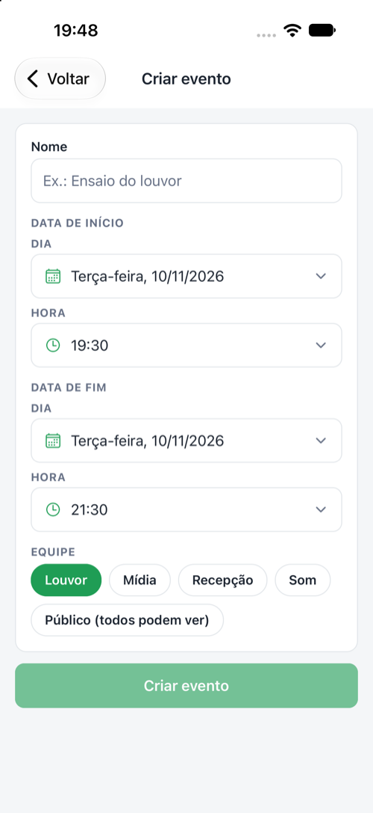 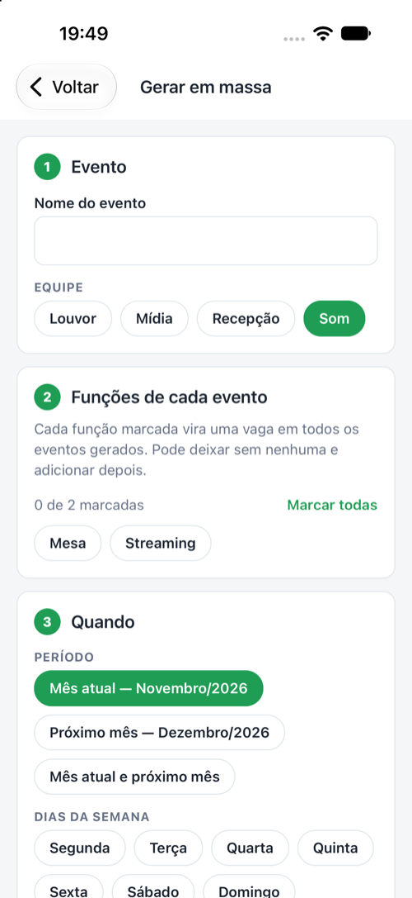 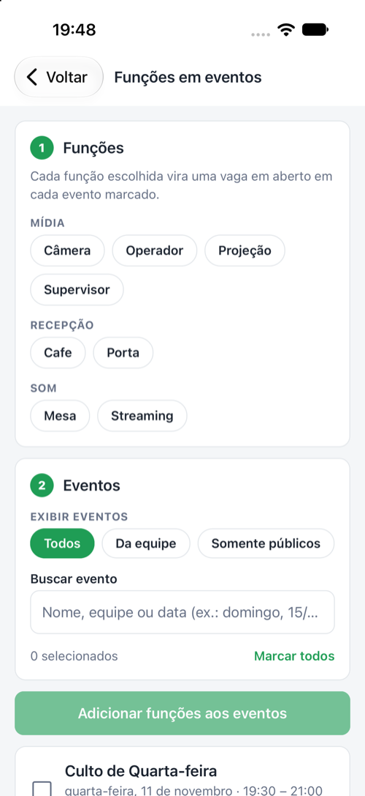

---

## 8. Escala fixa

Para equipes em que as mesmas pessoas servem nos mesmos cultos todo mês. Você configura **uma vez** e o sistema preenche os cultos sozinho. O padrão de toda equipe é **flexível** (escala culto a culto); a escala fixa só vale para quem ligar.

**App:** Liderança → Ferramentas → **Escala fixa**. **Site:** página de escalas da equipe → **Escala fixa**.

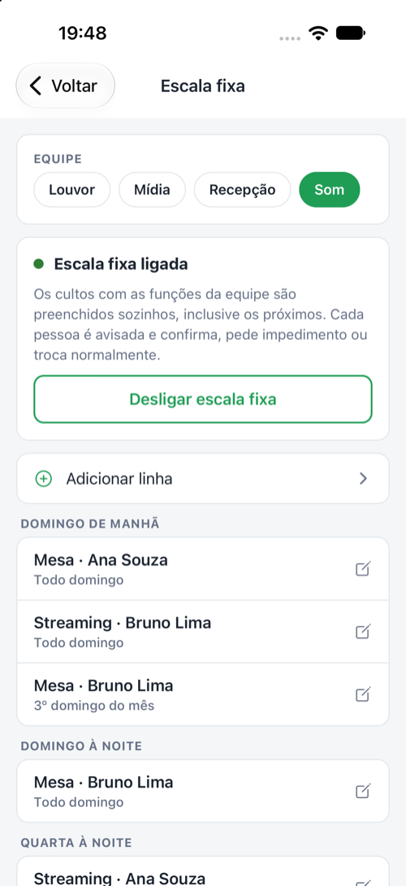 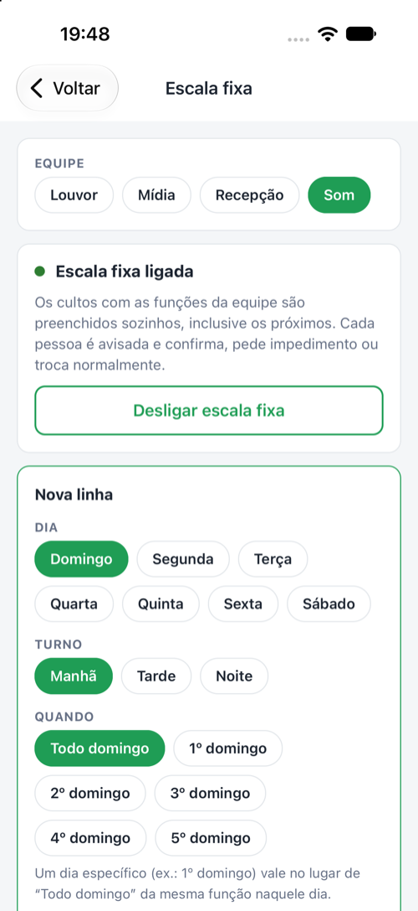

### Montar as linhas
Toque em **Adicionar linha** e escolha:

| Campo | Exemplo |
|---|---|
| **Dia** | Domingo |
| **Turno** | Manhã (até 12h), Tarde (até 17h) ou Noite |
| **Quando** | **Todo domingo**, ou um específico: **1º domingo**, **2º domingo**… **5º domingo** |
| **Função** | Mesa de som |
| **Pessoa** | Busque pelo nome |

Exemplo de uma equipe de som:

| Culto | Quando | Função | Pessoa |
|---|---|---|---|
| Domingo de manhã | Todo domingo | Mesa | Ana |
| Domingo de manhã | 3º domingo do mês | Mesa | Bia |
| Domingo de manhã | Todo domingo | Streaming | Caio |
| Quarta à noite | Toda quarta | Mesa | Davi |

No 3º domingo, a **Bia** fica na Mesa **no lugar da Ana** (a linha específica substitui o "Todo domingo" **da mesma função**). O Caio continua no Streaming em todos os domingos.

Duas pessoas na mesma função no mesmo culto? Cadastre duas linhas; se o culto tiver só uma vaga dessa função, o sistema cria a que falta.

### Ligar
Com as linhas prontas, toque em **Ligar escala fixa**. A partir daí:
- os cultos **já cadastrados** são preenchidos na hora;
- os cultos **cadastrados depois** são preenchidos assim que forem salvos;
- só entram cultos que **têm a função** da linha — evento especial sem a função da equipe fica de fora. Se a função for incluída depois (Funções em eventos), o culto é preenchido na hora;
- cada pessoa recebe **um aviso só** com o resumo ("Você está na escala fixa 🙌 · 8 cultos em dezembro").

Depois de salvar, o app mostra o resultado: quantos cultos foram preenchidos e quem **não pôde ser escalado** — por exemplo, já está escalado naquele culto em outra função/equipe, marcou que está ocupado ou saiu da equipe. Nesses casos a vaga fica aberta para você resolver.

### O que continua igual
- O voluntário confirma, recebe lembretes, pede impedimento ou troca normalmente.
- **Sua troca manual vale:** se você trocar a pessoa de um culto específico, a escala fixa não desfaz.
- **Impedimento aprovado vale:** a vaga fica aberta e não é preenchida de novo pela escala fixa.

### Mudar ou excluir uma linha
Toque na linha para editar ou **Excluir linha**. Mudam só os cultos futuros que a linha preencheu e que **ainda não foram confirmados**; quem saiu recebe "Sua escala mudou". As escalas já confirmadas ficam como estão (o app avisa quantas).

### Desligar
**Desligar escala fixa** volta a equipe ao modo flexível. Os cultos já preenchidos continuam como estão.

---

## 9. Escala em PDF

**Ferramentas → Escala em PDF**: escolha a **Equipe**, o **Mês** e o **Estilo do PDF**.
- **Compartilhar PDF:** abre as opções do celular — mandar no WhatsApp, salvar em Arquivos ou imprimir.
- **Abrir no navegador:** abre o PDF para ver ou baixar.

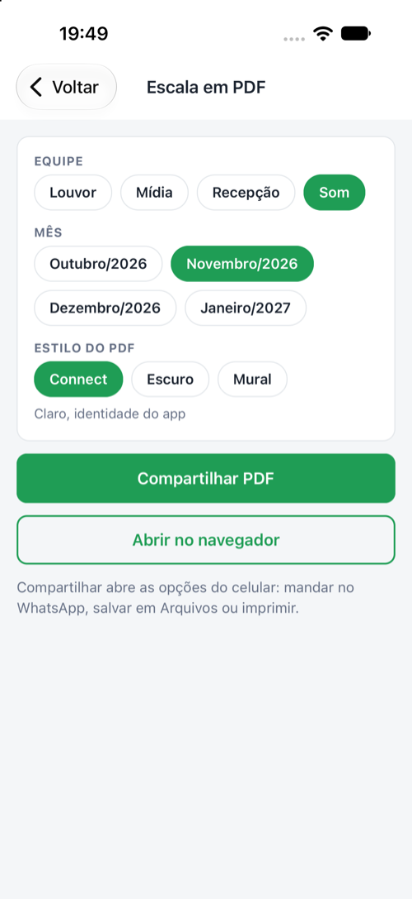

---

## 10. Gerenciar equipe

**Ferramentas → Gerenciar equipe** (se você lidera mais de uma, escolha a equipe no topo):
- **Funções:** criar, renomear e excluir (só funções que ainda não têm escalas, para não perder o histórico).
- **Líderes:** ver e remover lideranças. Para **adicionar** um líder, fale com a administração.
- **Integrantes:** **Adicionar integrante** (busque pelo nome) e remover. Ao remover alguém, as escalas já marcadas continuam — troque a pessoa no culto se precisar.
- Pedidos para entrar na equipe aparecem em **Pendências**.

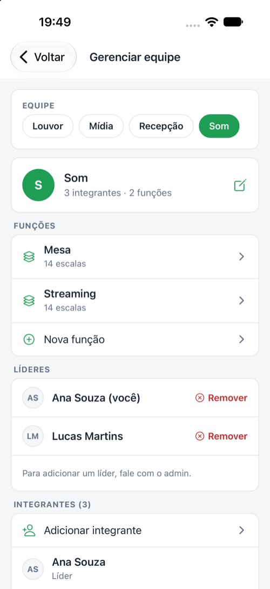

---

## 11. Avisos que o líder recebe

| Aviso | Quando |
|---|---|
| **Impedimento na escala** | Alguém da equipe não vai poder servir |
| **Pedido de troca** | Alguém pediu para deixar a escala |
| **Voluntário para a vaga / N pessoas querem servir** | Ofertas para vagas em aberto (agrupadas por culto) |
| **Nova candidatura** | Alguém pediu para entrar na equipe |
| **Vaga aberta na escala** | Um voluntário excluiu a conta e as escalas futuras dele viraram vaga |

Tocar no aviso abre a aba **Liderança** (ou a tela do culto, no caso das ofertas).

---

## 12. No site (connect.pibvp.org.br)

- **Painel do Líder:** resumo do mês (escalas, vagas, confirmações), **Pendências** com filtro por tipo, **Buracos na escala** (vagas com quem pode servir) e voluntários disponíveis que ainda não serviram no mês.
- **Escalas da equipe:** lista e **grade do mês**, **Auto-escalar**, **Exportar PDF**, **Ver Disponibilidades** e **Escala fixa**.
- Administração de cultos gerais, equipes e líderes: com a administração do sistema.

---

## 13. Boas práticas

- Peça a disponibilidade **no começo do mês** (ou no fim do anterior).
- Resolva impedimentos e trocas **no mesmo dia** — quanto mais perto do culto, mais difícil achar alguém.
- Equipes com escala estável: use a **escala fixa** e só ajuste as exceções.
- Antes do culto, confira **Cultos → Falta confirmar** e peça confirmação.
- Compartilhe o **PDF** no grupo da equipe quando a escala do mês estiver pronta.
