# Escala Connect — Manual do Voluntário

O **Escala Connect** é o aplicativo das escalas de voluntários da PIBVP. Por ele você vê quando vai servir, confirma presença, avisa quando não puder ir, informa os dias em que pode servir e recebe os lembretes no celular.

> Este manual vale para o app **versão 1.1.0** (Android e iPhone). Para ver sua versão: **Perfil → Aplicativo**.

---

## 1. Instalar e entrar

### Baixar o app
- **Android:** procure **Escala Connect** na Play Store.
- **iPhone:** use o link que a liderança enviar (o app não aparece na busca da App Store).

### Primeiro acesso
- **Já tenho conta no site** (connect.pibvp.org.br): entre com o **mesmo usuário e senha** do site.
- **Ainda não tenho conta:** na tela de entrada, toque em **Criar conta** e preencha nome, sobrenome, e-mail, CPF, data de nascimento, celular (opcional) e senha.
  - O CPF e a data de nascimento servem para você recuperar a senha se esquecer.
  - A senha precisa ter pelo menos 8 caracteres, não pode ser só números nem parecida com seu nome.

### Termo do voluntário
No primeiro acesso, leia e aceite o **termo do voluntário**. Depois disso o app libera todas as telas.

### Entrar numa equipe
Se você ainda não faz parte de nenhuma equipe, o **Início** mostra **"Entre em uma equipe"**. Escolha a equipe e toque em **Pedir para entrar**. A liderança aprova e você recebe o aviso **"Boas-vindas à equipe!"**.

Para ver ou pedir outras equipes depois: **Perfil → Minhas equipes**.

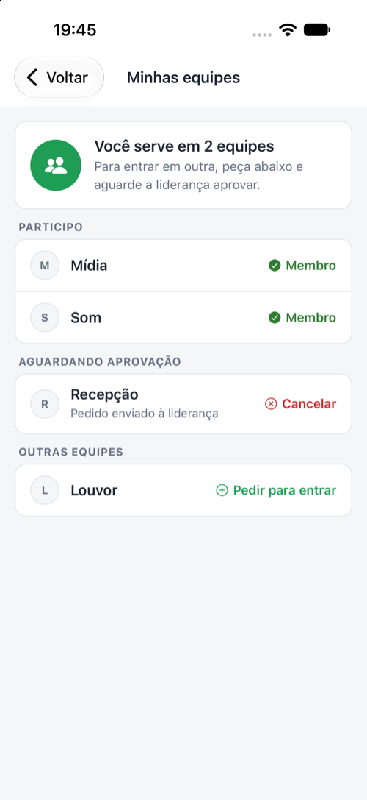

### Esqueci minha senha
Na tela de entrada, toque em **Esqueci minha senha** e informe seu CPF e sua data de nascimento.

### Tour do app
No primeiro acesso, o app mostra um passeio rápido pelas abas. Para ver de novo: **Perfil → Ver o tour do app**.

---

## 2. As abas do app

| Aba | Para que serve |
|---|---|
| **Início** | Sua próxima escala e o que precisa da sua atenção |
| **Escalas** | Todas as suas escalas: confirmar, avisar impedimento, pedir troca |
| **Calendário** | Cultos e eventos do mês e quem serviu nos que já passaram |
| **Disponibilidade** | Os dias em que você pode servir e as vagas em que você se ofereceu |
| **Perfil** | Seus dados, equipes, histórico, senha, Face ID/digital e mais |

O **sino** no alto do Início guarda todos os avisos que você recebeu.

---

## 3. Início

O Início mostra o que importa agora:
- **"Você serve hoje às…"** no dia da sua escala, com o botão **Confirmar presença** se ainda não confirmou.
- **Próximas escalas**: as próximas datas em que você serve.
- **Sua equipe precisa de ajuda**: há vagas em aberto em que você pode se oferecer (**Ver vagas**).
- **Informe sua disponibilidade**: aparece quando você ainda não marcou os dias do mês.
- **Complete seu contato**: aparece quando falta e-mail ou telefone.
- **Notificações desativadas**: aparece quando o celular está bloqueando as notificações do app (veja a seção 8).

Puxe a tela para baixo para atualizar.

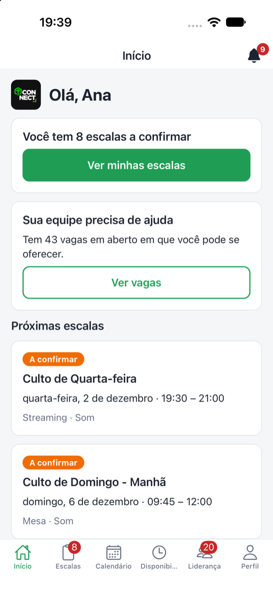

---

## 4. Minhas escalas

Na aba **Escalas** ficam todas as escalas em que você foi colocado. Use **Filtrar escalas** para ver só **A confirmar**, **Confirmadas** ou **Impedimento ou troca**.

Toque numa escala para abrir os detalhes: data, horário, função, equipe e **quem serve com você**.

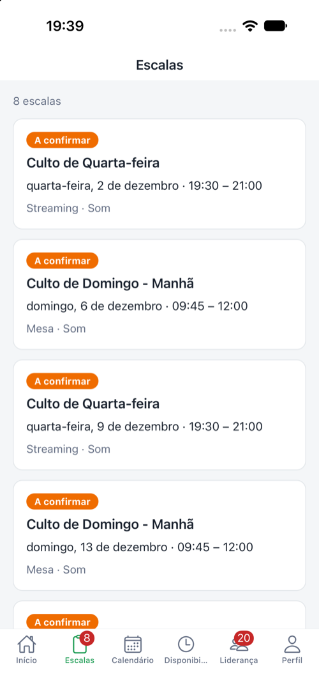 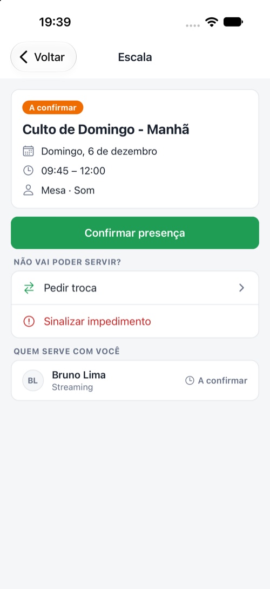

### Confirmar presença
Toque em **Confirmar presença**. Pronto: a liderança sabe que pode contar com você e os lembretes passam a ter tom de "até lá!".

### Não vou poder servir — Sinalizar impedimento
1. Abra a escala. Em **Não vai poder servir?**, toque em **Sinalizar impedimento**.
2. Escreva o motivo (só a liderança vê) e toque em **Enviar impedimento**.

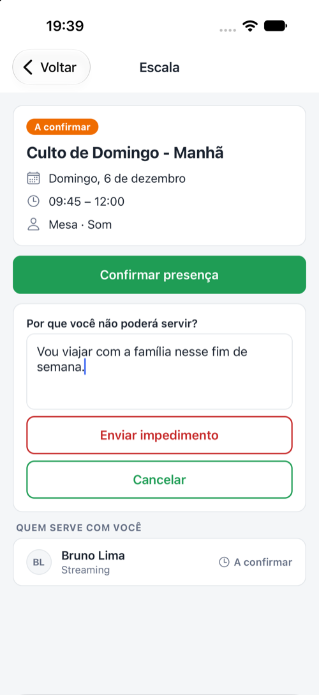

A liderança avalia. Você continua escalado até ela decidir:
- **Impedimento aceito:** você sai da escala e recebe o aviso "Impedimento aceito".
- **Pedido não aprovado:** você recebe "Você continua escalado".

Mudou de ideia? Abra a escala e toque em **Cancelar impedimento**.

### Pedir troca
Use quando você quer deixar a escala e a liderança colocar outra pessoa. Abra a escala e, em **Não vai poder servir?**, toque em **Pedir troca**. Para desistir do pedido: **Cancelar pedido de troca**.

> **Avise o quanto antes.** Quanto mais cedo a liderança souber, mais fácil encontrar outra pessoa.

---

## 5. Disponibilidade — quando posso servir

A liderança escala principalmente quem marcou que está disponível. Por isso é importante marcar seus dias todo mês.

1. Abra a aba **Disponibilidade** e toque em **Registrar disponibilidade**.
2. Aparecem os eventos dos **próximos 60 dias**. Use os filtros para achar rápido:
   - **Mês**
   - **Dias da semana** (pode escolher vários, ex.: só domingos)
   - **Culto** e **Equipe**
3. Marque os eventos em que você pode servir (ou marque todos de uma vez) e salve.

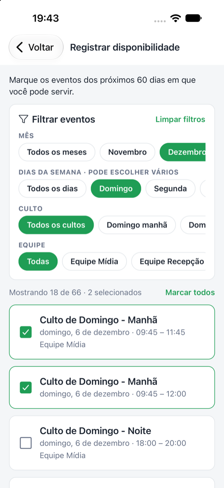

Na mesma aba você vê **Próximas disponibilidades** (pode **Excluir** alguma) e as **Vagas em que você se ofereceu**.

Quando a liderança pedir, você recebe o aviso **"Quando você pode servir?"**. Toque nele para ir direto para a tela de disponibilidade.

---

## 6. Vagas em aberto — "Quero servir"

Quando uma função da sua equipe está sem ninguém, ela aparece como **vaga em aberto**:
- no **Início** (Sua equipe precisa de ajuda → **Ver vagas**);
- no **Calendário**, ao tocar num culto (**Vaga em aberto**).

Toque em **Quero servir**. A liderança recebe seu pedido e decide. Enquanto isso aparece **"Você se ofereceu · Aguardando a liderança"**. Se for escolhido, você recebe **"Você foi escalado"**.

Não pode mais? Toque em **Desistir da oferta**.

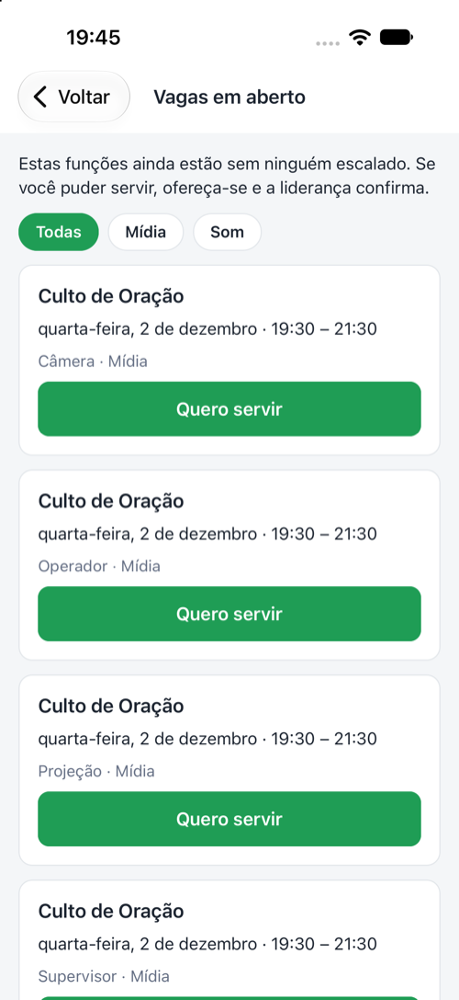

---

## 7. Calendário

Mostra os cultos e eventos do mês, com destaque nos dias em que você serve.
- **Filtrar eventos**: **Onde sirvo**, **Com vaga para mim** (quando há vagas no mês) e o tipo (**Cultos** ou a sua equipe).
- Toque num culto futuro para ver sua escala ou as vagas da sua equipe.
- Toque num culto que **já passou** para ver **quem serviu** em cada função.

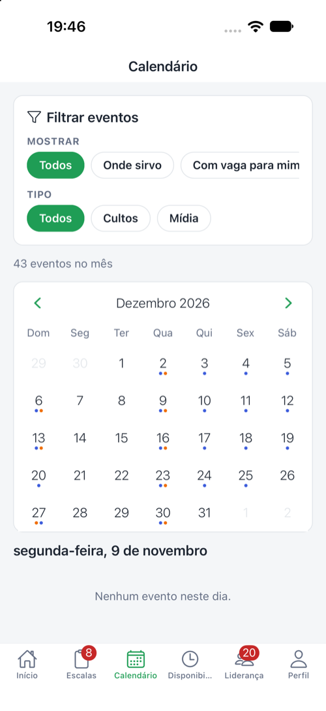 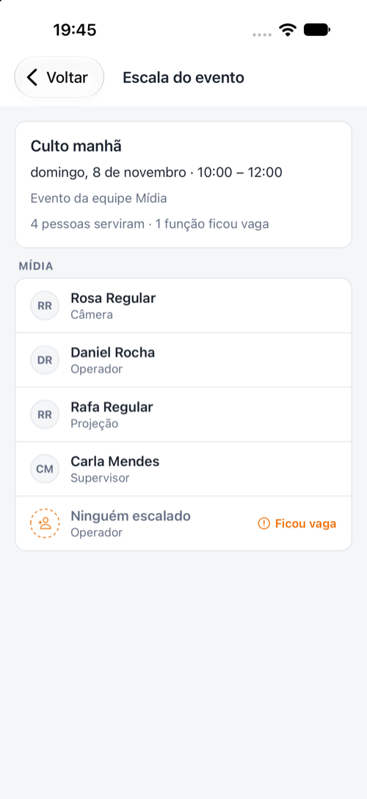

---

## 8. Avisos e notificações

Permita as notificações quando o app pedir — é por elas que chegam os lembretes. Todos os avisos também ficam guardados no **sino** (Início).

### Se as notificações estiverem desativadas
O app confere sozinho se o celular está bloqueando as notificações. Quando estão bloqueadas, o **Início** mostra o cartão **Notificações desativadas**:
- **Ativar notificações:** o celular pergunta se pode enviar notificações. Toque em **Permitir**.
- **Abrir os ajustes do celular:** aparece quando você já recusou antes, porque aí o celular não pergunta de novo. Nos ajustes, toque em **Notificações** e ative. Ao voltar para o app, o cartão some sozinho.

Você também vê e muda isso em **Perfil → Notificações**.

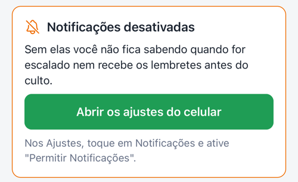

| Aviso | Quando chega |
|---|---|
| **Você foi escalado 🙌** | Quando a liderança coloca você numa escala |
| **Você está na escala fixa 🙌** | Quando sua equipe usa escala fixa e você entra em vários cultos de uma vez (um aviso só com o resumo) |
| **Confirma sua escala?** | Pedido de confirmação da liderança ou na véspera, às 18h, se você ainda não confirmou |
| **Amanhã é dia de servir / Hoje você serve às…** | Lembrete: culto de manhã → na véspera às 20h; culto à tarde ou à noite → no próprio dia às 12h |
| **Sua escala começa às…** | 2 horas antes, só para quem ainda não confirmou |
| **Impedimento aceito / Troca aprovada** | Quando a liderança libera você |
| **Você continua escalado** | Quando a liderança não aprova seu pedido |
| **Mudança na sua escala / Sua escala mudou** | Quando a liderança coloca outra pessoa no seu lugar (antes de você confirmar) |
| **Quando você pode servir?** | Pedido para marcar a disponibilidade do mês |
| **Boas-vindas à equipe!** | Quando sua entrada na equipe é aprovada |

Tocar no aviso abre a tela certa (a escala, a lista de escalas, a disponibilidade…).

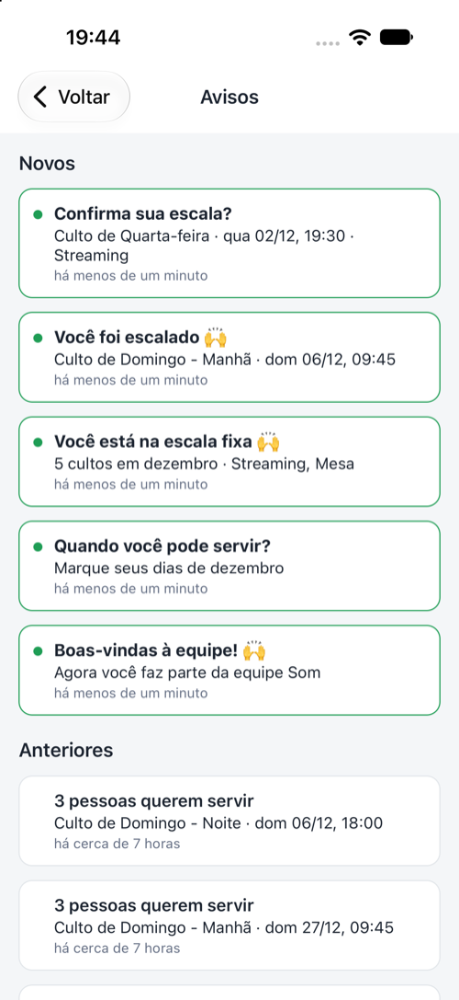

---

## 9. Perfil

| Item | O que faz |
|---|---|
| **Minhas equipes** | Equipes em que você serve e pedidos para entrar em outras |
| **Meu histórico** | Quantas vezes você serviu (no mês, no ano, no total), por função, e as últimas escalas |
| **Minhas escalas no calendário** | Coloca suas escalas na agenda do celular. No iPhone a agenda se atualiza sozinha; no Android o arquivo é importado na agenda |
| **Atualizar contato** | E-mail e telefone |
| **Trocar senha** | Altera sua senha (a mesma do site) |
| **Entrar com Face ID / digital** | Opcional: pede o Face ID ou a digital ao abrir o app (depois de 5 minutos fora). Se falhar, dá para sair e entrar com a senha |
| **Excluir minha conta** | Apaga seus dados pessoais e encerra a conta (veja abaixo) |
| **Notificações** | Mostra se as notificações estão ativadas e ajuda a ativar (ou abre os ajustes do celular) |
| **Ver o tour do app** | Mostra de novo o passeio pelas abas |
| **Verificar atualização** | Procura uma versão nova do app |
| **Sair** | Desconecta a conta deste celular |

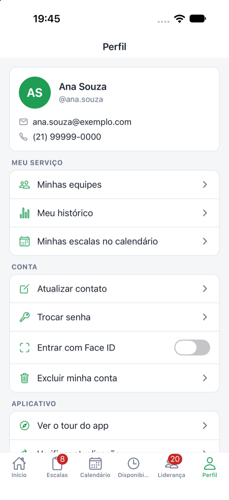 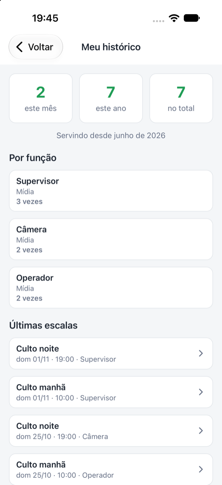

### Atualizações do app
Quando houver novidade, aparece a faixa **"Nova versão disponível · Atualizar"**. Toque nela — leva poucos segundos. Algumas versões precisam ser instaladas pela loja; nesse caso o app avisa.

### Excluir minha conta
**Perfil → Excluir minha conta**, digite sua senha e confirme. **Não dá para desfazer.**
- Seu nome, e-mail, CPF, telefone e datas são apagados e você não consegue mais entrar.
- Você sai das equipes e suas disponibilidades são apagadas.
- Suas próximas escalas ficam em aberto e a liderança é avisada.
- As escalas em que você já serviu continuam no histórico como "Ex-voluntário".

---

## 10. Perguntas frequentes

**Não estou recebendo os lembretes.**
Veja em **Perfil → Notificações** se estão ativadas; se não, toque para ativar. Os avisos também ficam no sino do Início.

**Fui escalado num dia em que não posso.**
Abra a escala e toque em **Sinalizar impedimento**, com o motivo. Avise o quanto antes.

**Quero servir mais vezes.**
Marque mais dias na **Disponibilidade** e fique de olho nas **vagas em aberto** (Início e Calendário).

**Esqueci a senha.**
Na tela de entrada → **Esqueci minha senha** (CPF + data de nascimento).

**Troquei de celular.**
Instale o app no celular novo e entre com o mesmo usuário e senha. Os lembretes passam a chegar no celular novo.

**O app e o site são a mesma coisa?**
Sim. Usuário, senha, escalas e disponibilidades são os mesmos no app e em connect.pibvp.org.br.

**Ainda tenho dúvidas.**
Fale com a liderança da sua equipe.
